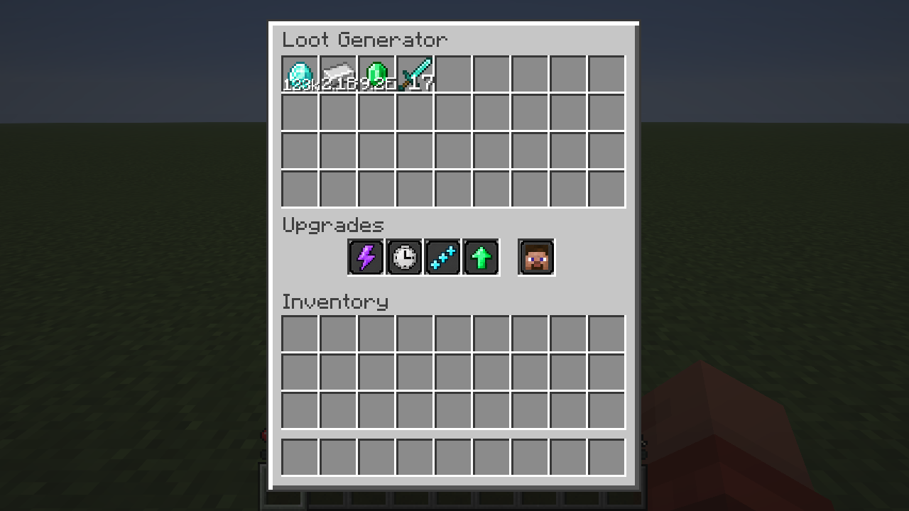
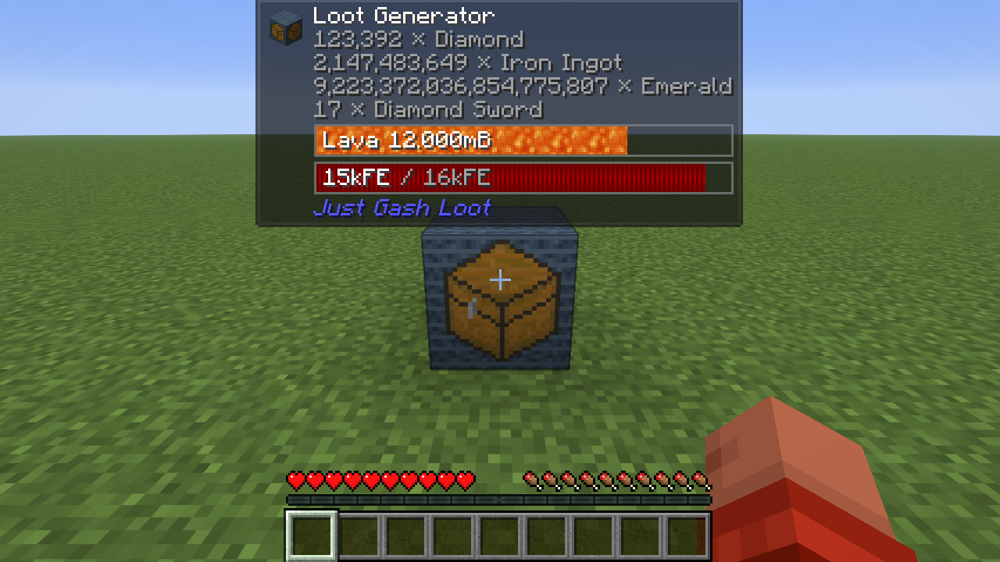

# Just Gash Loot

Mod de Minecraft por **Gasharaujo**. Versão inicial **0.1.0**. **All Rights Reserved**.

Esta versão implementa o Loot Generator, armazenamento, interface e itens de upgrades.
A geração de loot, os efeitos dos upgrades e as receitas serão desenvolvidos depois.

## Instalação

Use somente o JAR correspondente ao Minecraft e loader da instância:

| Minecraft | Loader de referência | Arquivo em `artifacts/` |
| --- | --- | --- |
| 1.20.1 | Forge 47.4.10 | `justgashloot-forge-1.20.1-0.1.0.jar` |
| 1.21.1 | NeoForge 21.1.248 | `justgashloot-neoforge-1.21.1-0.1.0.jar` |
| 26.1.2 | NeoForge 26.1.2.109 | `justgashloot-neoforge-26.1.2-0.1.0.jar` |

Instale em cliente e servidor. Jade é opcional. A integração foi preparada para
Jade 11.13.3, 15.10.6 e 26.1.12, respectivamente. Os JARs do Jade não são incluídos.

Obtenha os itens na aba **Just Gash Loot** do criativo ou usando:

```mcfunction
/give @s justgashloot:loot_generator
/give @s justgashloot:speed_upgrade_1
/give @s justgashloot:player_upgrade
```

## Loot Generator

- 36 saídas em grade 9×4, exclusivamente para retirada.
- Cada saída guarda um tipo de item com seus dados e até `9.223.372.036.854.775.807` unidades.
- Quatro slots gerais permitem um Energy, Speed, Quantity e Quality, sem repetir categoria entre níveis.
- O quinto slot recebe exclusivamente o Player Upgrade.
- Energy, Speed, Quantity e Quality têm cinco níveis; Player não tem níveis.
- Upgrade Base e Loot Tablet são itens reservados, sem função nesta versão.
- Clique esquerdo retira uma pilha normal; direito retira uma unidade; Shift preenche o espaço disponível no inventário.
- Teclas numéricas retiram para espaços compatíveis da hotbar; as saídas nunca recebem itens do jogador.
- A contagem abreviada aparece sobre o item na GUI; o tooltip mostra a contagem completa.

O tanque armazena **16.000 mB de lava** e a bateria **16.000 FE**, sem consumo.
Baldes de lava e baldes vazios interagem diretamente com o bloco; tubos e cabos
podem acessar qualquer face. FE é somente de entrada. Essas capacidades aparecem
no Jade e em HUDs que consultam as APIs dos loaders, e não na GUI.

Funis e tubos retiram das saídas. Inserção externa de itens é rejeitada;
upgrades são manipulados manualmente. A geração ainda não preenche as saídas;
os testes usam inserção interna exclusivamente no ambiente de desenvolvimento.

## Contagens e integrações

O estoque real usa contadores `long`, separados dos `ItemStack`s. A integração
opcional do Jade transmite esses contadores integralmente, sem reduzi-los a 64.
Os ícones transmitidos continuam sendo pilhas válidas; a contagem segue separada.

No NeoForge 26.1.2, o handler padrão informa as quantidades completas de 64 bits.
No Forge 1.20.1 e NeoForge 1.21.1, a API padrão `IItemHandler` representa contagens
com `int`: a consulta informa o estoque até `2.147.483.647` por slot e satura nesse
valor para estoques maiores. Isso é uma limitação da interface antiga; o estoque
real e a leitura do Jade continuam exatos. Sistemas externos que consultam apenas
essa interface podem mostrar esse teto até o estoque baixar novamente.
As extrações antigas respeitam o limite normal do item, conforme o contrato da API.

## Quebra

O cálculo considera as pilhas normais das saídas, os upgrades e o item do bloco.
Até **300 pilhas**, a quebra é normal. Acima disso, o jogador recebe um aviso no
chat e precisa agachar para confirmar. Lava e FE são sempre descartados.

Explosões e tentativas de mineração automática que passam pelos eventos do loader
são bloqueadas acima do mesmo limite. Fake players não confirmam a quebra por Shift.
Comandos administrativos ou mods que removem blocos sem esses eventos ficam fora
dessa proteção. O bloco recolhido fica vazio. Estoques extremos podem causar lag
quando o jogador confirma a queda em pilhas normais.

## Desenvolvimento

Os projetos usam JDK 17, 21 e 25, respectivamente. Os wrappers Gradle e as
dependências têm versões fixas. O código comum mantém regras, inventário e menu;
adaptadores por versão cobrem registros, persistência, rede, GUI e capabilities.

```powershell
python .\tools\generate_resources.py
.\tools\test-core.ps1
.\tools\build.ps1
.\tools\build.ps1 -Offline -Install
```

`-Install` copia os JARs para as instâncias locais `20.1`, `21` e `26.1.2` do CurseForge.
JARs anteriores deste mod são desativados com extensão `.disabled`.

Para integração, em cada módulo, com o JDK correspondente:

```powershell
.\gradlew.bat -Pverification verifyServer
```

Use um diretório de desenvolvimento isolado e aceite o EULA do Minecraft nesse
diretório antes de executar o servidor. Os relatórios ficam no diretório de execução.
`verifyServer` falha se o relatório não confirmar todos os testes.
Os testes de GUI usam `-Pverification -PuiVerification runClient`, com um mundo
`JglGuiTest` previamente criado em `build/ui-client/saves/`. Para carregar Jade no
NeoForge, acrescente `-PjadeJar=C:\caminho\Jade.jar`; no Forge use `-PjadeRuntime`.
Os comandos e classes de verificação são excluídos dos JARs de distribuição.

Os originais gráficos permanecem em `assets/`. A preparação das cópias usadas no
jogo usa dimensões quadradas em potência de dois, proporção preservada,
transparência e amostragem pelo vizinho mais próximo. Isso mantém os mipmaps do
atlas do Minecraft. O script também gera modelos, traduções e loot tables por versão.

## Verificação desta versão

Resultados e limites de compatibilidade estão em [docs/VALIDATION.md](docs/VALIDATION.md).




