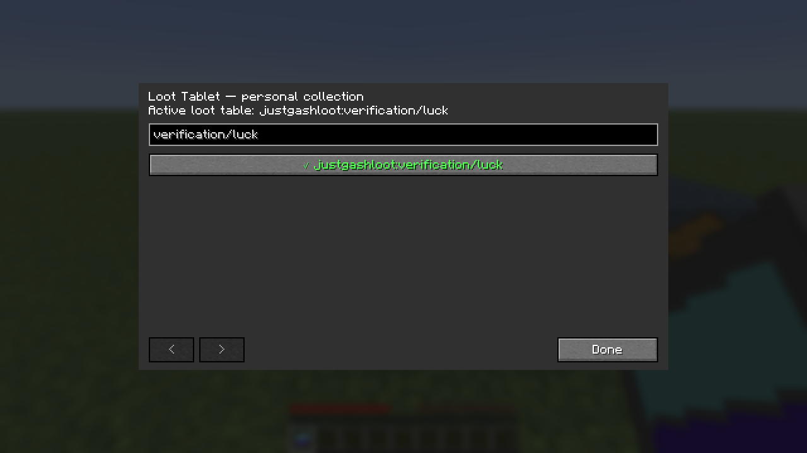

# Just Gash Loot

Mod de Minecraft por **Gasharaujo**, versão **2.0.0**. **All Rights Reserved**.

O Loot Generator reproduz loot tables capturadas com o Loot Tablet, usando FE ou lava.
Possui armazenamento de grandes contagens e upgrades de economia, velocidade, quantidade,
luck e contexto de jogador.

## Instalação

Instale o mesmo JAR no cliente e no servidor, escolhendo a versão correspondente:

| Minecraft | Loader de referência | Arquivo em `artifacts/` |
| --- | --- | --- |
| 1.20.1 | Forge 47.4.10 | `justgashloot-forge-1.20.1-2.0.0.jar` |
| 1.21.1 | NeoForge 21.1.248 | `justgashloot-neoforge-1.21.1-2.0.0.jar` |
| 26.1.2 | NeoForge 26.1.2.109 | `justgashloot-neoforge-26.1.2-2.0.0.jar` |

Jade e Lootr são opcionais. Referências de integração, na mesma ordem:

| Minecraft | Jade | Lootr |
| --- | --- | --- |
| 1.20.1 | 11.13.3 | 0.7.35.94 |
| 1.21.1 | 15.10.6 | 1.11.38.127 |
| 26.1.2 | 26.1.12 | 1.23.38.123 |

Os IDs anteriores foram preservados. Máquinas da 0.1.0 mantêm estoques, upgrades,
lava e FE, começando sem tabela configurada. Um Player Upgrade antigo deve ser
retirado e reinstalado para registrar seu instalador.

## Loot Tablet

1. Use botão direito em um recipiente com uma loot table para salvar e ativar a tabela.
2. Use Shift + botão direito para abrir a coleção pessoal, buscar por ID e selecionar outra tabela.
3. Use botão direito no Loot Generator para aplicar a tabela ativa ao bloco.

Todos os tablets de um jogador compartilham sua coleção e seleção neste mundo.
Morrer, reconectar ou trocar de dimensão não apaga a coleção. A seleção aparece
na tooltip do tablet. Máquinas já configuradas mantêm sua própria tabela quando
o jogador muda a seleção pessoal. Capturar ou configurar não consome o tablet.

A captura não abre nem esvazia o recipiente. No vanilla, é necessário capturar
antes de a tabela ser apagada pela geração do conteúdo. O ID é o da tabela real,
por exemplo `minecraft:chests/nether_bridge`.

Lootr é reconhecido pelos provedores disponíveis em cada versão: baús, barris,
shulkers, carrinhos, jarros, blocos arqueológicos, item frames e demais provedores
compatíveis. **Só tabelas reais são copiadas**. Conteúdos fixos por jogador e tabelas
auxiliares vazias, inclusive as usadas por certos item frames, são recusados com aviso.
Drops de mobs não são capturados. Tabelas indisponíveis continuam na coleção, mas
não podem ser aplicadas até voltarem a existir.

## Geração e upgrades

Cada execução sorteia novamente a tabela e armazena o resultado. A máquina usa
20 ticks por segundo e só trabalha enquanto o chunk estiver carregado.

Cada coluna abaixo corresponde à sua própria categoria de upgrade:

| Nível | Energy: intervalo de cobrança | Speed: ciclo lava | Speed: ciclo FE | Quantity: execuções totais | Quality: luck adicional |
| --- | --- | --- | --- | --- | --- |
| Sem upgrade | 1 tick | 40 s | 20 s | 1 | 0 |
| T1 | 2 ticks | 20 s | 10 s | 2 | 1 |
| T2 | 4 ticks | 10 s | 5 s | 3 | 5 |
| T3 | 8 ticks | 5 s | 3 s | 5 | 15 |
| T4 | 16 ticks | 3 s | 1 s | 6 | 50 |
| T5 | 32 ticks | 2 s | 0,2 s | 8 | 100 |

**Speed acelera o consumo na mesma proporção que a geração.** A cobrança básica
é 1 mB de lava ou 60 FE, multiplicada pelo fator de velocidade da fonte. Sem Energy,
um ciclo inteiro custa 800 mB de lava ou 24.000 FE, qualquer que seja o Speed.
Quantity acrescenta sorteios independentes sem multiplicar o gasto novamente.

No Speed T5, cada cobrança é de 20 mB ou 6.000 FE. Com Energy T5, essa cobrança
concede 32 ticks ativos e pode alimentar oito ciclos rápidos com FE. O custo médio
é reduzido pelo intervalo do Energy. Frações, como 13⅓ mB no Speed T4, são acumuladas
sem perda de precisão.

A cada cobrança, FE tem prioridade se houver o valor completo; caso contrário,
a máquina tenta lava. A mudança de fonte preserva a fração concluída do ciclo.
Sem recursos, o progresso pausa. A bateria de 16.000 FE exige reposição durante
um ciclo de 24.000 FE sem Energy.

Mudanças nos upgrades gerais entram no próximo ciclo e descartam créditos da
configuração anterior. Trocar a tabela ou o jogador associado reinicia o progresso.
Progresso, créditos e frações são salvos; tempo descarregado não é compensado.

Quality fornece luck ao contexto. Só tabelas que utilizam luck terão seus resultados
alterados; o upgrade não reescreve probabilidades de tabelas que ignoram esse atributo.

O Player Upgrade associa a máquina a quem o instalou. Online, usa o jogador real;
offline, um jogador simulado apenas com UUID e nome, sem copiar inventário,
equipamentos ou atributos. Quality continua válido. Mods podem distinguir o jogador
simulado. Remover e reinstalar o upgrade registra o novo instalador.

Se uma tabela desaparecer, a máquina pausa sem consumir. Erros de execução também
pausam a geração e ficam registrados no log; reaplicar a tabela ou recarregar seus
dados permite tentar novamente. **Resultados que não couberem serão descartados.**

## Inventário e automação

- 36 saídas em grade 9×4, exclusivamente para retirada.
- Cada saída guarda um tipo de item com seus dados e até `9.223.372.036.854.775.807` unidades.
- Quatro slots recebem Energy, Speed, Quantity e Quality em qualquer ordem, sem repetir categoria.
- O quinto recebe exclusivamente Player. Cada upgrade empilha uma unidade.
- Esquerdo retira uma pilha normal; direito retira uma unidade; Shift preenche o espaço disponível no inventário.
- A GUI mostra contagens abreviadas e o tooltip mostra o valor completo.

O tanque comporta 16.000 mB de lava e a bateria 16.000 FE. Baldes e tubulações
acessam qualquer face. FE é somente de entrada; água e outros fluidos são rejeitados.
Esses recursos aparecem no Jade e nas APIs dos loaders, sem barras na GUI.

Funis e tubos só retiram itens das saídas; inserção externa é bloqueada. Upgrades
são manuais. O Jade recebe as contagens exatas separadas dos ícones dos itens.

Em 1.20.1 e 1.21.1, a consulta padrão `IItemHandler` usa `int` e satura em
2.147.483.647 por slot; estoque real e Jade permanecem exatos. Cabos que consultam
apenas essa interface podem mostrar esse teto. O handler do NeoForge 26.1.2 informa
as contagens completas em `long`. A compatibilidade individual de cada cabo de
modpack não foi verificada.

## Receitas

Todas produzem uma unidade e consomem os ingredientes da matriz:

| Item | Matriz | Ingredientes |
| --- | --- | --- |
| Loot Tablet | `nnn / cac / nnn` | `n`: pepita de ferro; `c`: painel de vidro ciano; `a`: painel de vidro azul-claro |
| Loot Generator | `frf / btb / frf` | `f`: barra de ferro; `r`: redstone; `b`: baú; `t`: Loot Tablet |
| Upgrade Base | `nMn / MUM / nMn` | `n`: pepita de ferro; `M`: ardósia polida; `U`: bloco de redstone |
| Upgrades | `nMn / MUM / nMn` | Regras abaixo |

Nos upgrades com níveis, `M` progride por blocos de ferro, ouro, diamante, esmeralda
e obsidiana chorona. `U` é Upgrade Base no T1 e o upgrade da mesma categoria e nível
anterior nos demais. Os quatro `n` são blocos de redstone para Energy, relógios para
Speed, itens/livros com Fortune exatamente III para Quantity e itens/livros com Looting
exatamente III para Quality. Outros encantamentos e dano são permitidos, e os quatro
itens encantados podem ser diferentes. Níveis II e IV não servem.

Player tem um único nível: quatro estrelas do Nether, quatro blocos de ferro e
Upgrade Base no centro.

## Quebra

Até 300 pilhas normais, contando saídas, upgrades e o bloco quando aplicável,
a quebra é normal. Acima disso, o jogador recebe aviso e precisa agachar para
confirmar. A confirmação derruba todas as pilhas; estoques extremos podem causar lag.

Explosões e mineração automática identificável pelos eventos dos loaders são
bloqueadas acima do limite. Fake players não confirmam por Shift. Remoções que
ignorem esses eventos ficam fora da proteção. Lava e FE são perdidos, e o bloco
recolhido fica vazio.

## Desenvolvimento e verificação

Os projetos usam JDK 17, 21 e 25. Código comum mantém armazenamento e regras;
adaptadores por versão cobrem APIs do Minecraft e dos loaders.

```powershell
python .\tools\generate_resources.py
.\tools\test-core.ps1
.\tools\build.ps1 -Offline -Install
```

`-Install` copia os JARs para as instâncias CurseForge `20.1`, `21` e `26.1.2`,
desativando versões anteriores do mod. Os originais gráficos permanecem em `assets/`.

Para testes, em cada módulo com o JDK correspondente:

```powershell
.\gradlew.bat -Pverification verifyServer
```

Use diretório isolado e aceite o EULA do Minecraft nele. Para verificar a coleção
salva por uma execução anterior, acrescente `-PexpectLibrary`. Nos NeoForge, carregue
Jade e Lootr usando `-PjadeJar=C:\caminho\Jade.jar` e `-PlootrJar=C:\caminho\Lootr.jar`.
No Forge, use `-PjadeRuntime` e `-PlootrRuntime`; as versões de referência são fixas.

O teste de cliente usa `-Pverification -PuiVerification runClient`, com um mundo
`JglGuiTest` previamente criado em `build/ui-client/saves/`. Testa capturas, busca,
paginação, seleção e configuração por pacotes reais. Comandos, classes e loot tables
de verificação são excluídos dos JARs de distribuição.

Resultados e limites estão em [docs/VALIDATION.md](docs/VALIDATION.md).



